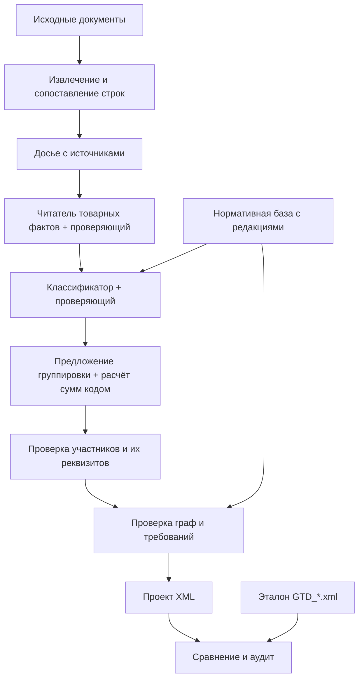

# Проверка деклараций по эталонным XML

Оценщик читает декларацию специалиста после генерации и сериализации проекта.
Для `GTD_*.xml` в формате AltaGTD сравнение выполняется напрямую. В `example_5`
электронная ДТ ESADout_CU вложена в ED_Container рядом с отметками таможни.
Для этого формата оцениваются поля с явным соответствием в AltaGTD. Полный перечень
исходных путей, значений и соответствий сохраняется в `source_fields` отчёта аудита.
Конвейер генерации получает только документы поставки.

## Два вида входного комплекта

Основной регрессионный тест использует отдельные документы вне `GTD.ZIP`.
`scripts/extract-declaration-cases.py --include-alta-support` дополнительно читает
самостоятельные документы архива, исключая рабочие таблицы ДТ, корректировки,
формы стоимости и служебную опись. `evaluate-declarations.py` требует отдельный
флаг `--allow-alta-support` для такого входа и отмечает `input_scope=archive_assisted`.

Оформленный в Альта упаковочный лист может уже содержать описания и группировку
готовой ДТ. Улучшение с этим входом показывает доступность сведений в архиве,
но не доказывает, что агент самостоятельно восстановил их из первоначальных
коммерческих документов. Карточки FRB без тела вложения не заменяют сам документ.

## Этапы агента

1. Извлечение/OCR, выбор ролей и редакций документов, сопоставление физических строк.
2. Неизменяемое досье с полными текстами, наблюдениями, реестром и происхождением фактов.
3. Технические признаки по точному артикулу; повторное чтение недостающих товарных
   сведений с отдельной проверкой предложений. Сохраняются старое значение и цитата.
4. План поиска классификации, локальный поиск норм, отдельное обоснование каждой
   строки, проверка ссылок и спорных решений. Для больших поставок — до шести строк
   на вызов. Точный десятизначный код, включая запись с пробелами, имеет приоритет
   при поиске и отборе контекста; выбор редакции остаётся отдельной проверкой.
   Иностранные коды и российские кандидаты хранятся раздельно.
5. Предложение группировки. Суммы считает код с Decimal; исходные строки сохраняются.
6. Проверка тождества и реквизитов участников сделки отдельными ролями.
7. Проверка граф и нормативных оснований с ограниченным контекстом, затем XML-адаптер.



Неполная классификационная гипотеза не стирает прямо прочитанный код. Такой код
остаётся кандидатом проекта с открытым вопросом, а не юридически подтверждённым
решением. Ручные поля защищены от повторного чтения. Даты/курсы/ставки/процедуры
не подставляются из эталона. Для окончательного XML требуется закрыть замечания.

Вызовы ролей и проверяющих можно направлять на разные модели через функцию
`complete`. Backend использует настроенные `analysis` и `review`; две проверки
одной моделью не гарантируют независимости её ошибок.

## Повторный прогон

Запускать из корня проекта с настроенным `DEEPSEEK_API_KEY` или с `--key-file`.
Все выходы с документами клиентов следует хранить локально вне Git.

Для добавленного комплекта запустите `scripts/extract-declaration-cases.py` с
`--input /path/to/examples --case example_5 --output .local/declaration-eval`.
Тот же фильтр `--case example_5` доступен при генерации и аудите.

```sh
backend/.venv/bin/python scripts/evaluate-declarations.py \
  --cache .local/declaration-eval \
  --expected /path/to/examples \
  --output .local/reference-run \
  --model-cache .local/declaration-eval/results/model-cache
```

`--prepare-only` сохраняет досье без обращения к эталону. `--dossier-dir` использует
сохранённые досье с проверкой идентичности входных документов. `--refresh-register`
перечитывает только реестр представленных документов при проверке новой версии
его обработчика. OCR и модельные ответы могут переиспользоваться; отчёт отмечает
новые вызовы и попадания в кэш. Это регрессия на известных примерах, не новая
независимая тестовая выборка.

Профиль модели задаётся явно: `--thinking on --reasoning-effort max` (значение по
умолчанию) или `--thinking off` для сравнения с прежним прогоном без Thinking.
Лимит ответа по умолчанию — 65536 с Thinking и 32768 без него; его можно изменить
через `--max-tokens`. Профиль включается в отчёт и ключ кэша. Результаты разных
профилей следует показывать отдельно: изменение качества нельзя целиком приписать
коду, если одновременно изменился режим модели.

```sh
backend/.venv/bin/python scripts/audit-reference-declarations.py \
  --expected /path/to/examples \
  --actual .local/reference-run \
  --baseline .local/previous-run \
  --sources .local/declaration-eval \
  --output .local/reference-audit
```

Необязательный `--expanded` указывает отдельный кэш с архивными документами для
поиска объяснений расхождений, не для изменения результата генерации.

Аудит включает все непустые XML-реквизиты и атрибуты, 54 графы каждого примера,
каждый товар и уникальные документы графы 44. Позиционное совпадение XML зависит
от группировки/порядка и включает служебные поля. Поэтому дополнительно показаны
состав кодов, суммы и соответствия по коду/стране. Буквальное попадание значения
в исходный текст не считается доказательством его правильной роли; отсутствие
попадания не доказывает отсутствия сведений.

## Внешние инструменты

Текущая классификация использует локальные снимки нормативной базы. Для применения
редакции требуется дата подачи и подтверждённый период её действия. Для курсов
полезен отдельный инструмент [XML Банка России](https://www.cbr.ru/development/sxml/)
с явно заданной датой; официальный интерфейс поддерживает `date_req`.

Поиск DuckDuckGo может находить официальные нормативные источники и документацию
изготовителя. Выдача не является доказательством происхождения, состава конкретной
партии или условий сделки. Подключение такого поиска в рабочий конвейер требует
доступной выдачи и последующего чтения найденного первоисточника с сохранением
ссылки, текста и даты. Автоматическое применение найденного текста не реализовано.

Подсказки видов документов проверялись по [классификатору №378](https://www.alta.ru/tamdoc/10sr0378/).
Они остаются предложениями; устаревший код упаковочного листа 02026 не присваивается.
